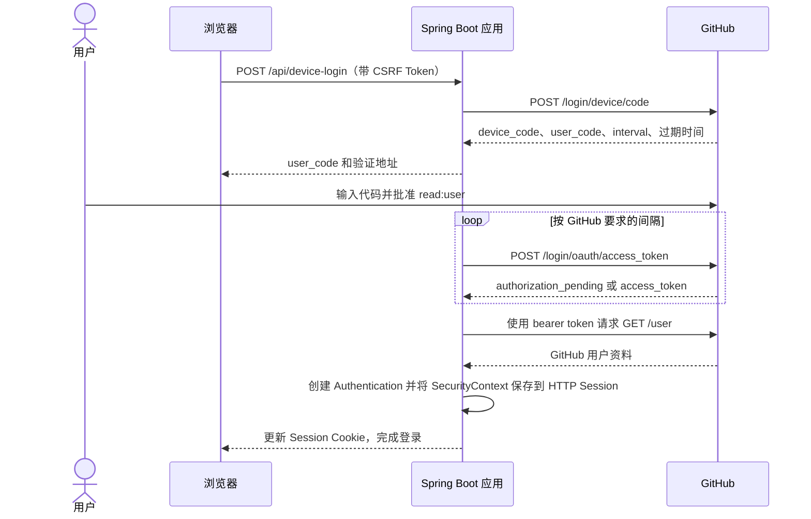

# Spring Security GitHub Device Flow 登录示例

[](https://adoptium.net/)
[](https://spring.io/projects/spring-boot)
[](https://spring.io/projects/spring-security)
[](LICENSE)
[](https://docs.github.com/en/apps/oauth-apps/building-oauth-apps/authorizing-oauth-apps#device-flow)

这是一个可运行的教程示例：通过 GitHub OAuth Device Flow 登录，并由 Spring Security 建立本站 HTTP Session。

> 示例使用 Spring `RestClient` 调用 GitHub Device Flow 接口；Spring Security 管理本站认证和 Session。它没有使用 `oauth2Login()`，也没有内置的 OAuth2 Client Device Flow 实现：Spring Security 的 OAuth2 Login 使用授权码流程。

## 环境要求

- Java 25
- 已启用 Device Flow 的 GitHub OAuth App
- GitHub OAuth App 的 **Client ID**

Device Flow 不需要 OAuth App 的 Client Secret。项目不使用该 Secret，也不要把它发给协助你配置的人。

## 创建并配置 GitHub OAuth App

1. 打开 GitHub **Settings → Developer settings → OAuth Apps → New OAuth App**。
2. 填写应用名称和 Homepage URL。本地演示可填 `http://localhost:8080`。
3. 如果表单要求填写 Authorization callback URL，可填 `http://localhost:8080/`。Device Flow 不使用此回调地址。
4. 创建应用后打开应用设置，启用 **Device Flow** 并保存。
5. 复制应用的 **Client ID**。不要复制或配置 Client Secret。

GitHub 设置界面可能会调整，请参考[创建 OAuth App 官方文档](https://docs.github.com/en/apps/oauth-apps/building-oauth-apps/creating-an-oauth-app)和[Device Flow 官方文档](https://docs.github.com/en/apps/oauth-apps/building-oauth-apps/authorizing-oauth-apps#device-flow)。

## 本地运行

在 zsh 或 bash 中，将 Client ID 导出到启动应用的同一个终端：

```sh
export GITHUB_CLIENT_ID='你的 OAuth App Client ID'
./mvnw spring-boot:run
```

也可以复制 `.env.sample` 为 `.env`，填入 `GITHUB_CLIENT_ID` 后启动应用。Spring Boot 会导入这个本地配置文件。修改 Client ID 后需要重启应用。

打开 <http://localhost:8080>。Maven 会安装项目固定版本的 Node/npm、检查并构建前端，然后由 Spring Boot 提供静态页面。

可以打开 <http://localhost:8080/api/config> 检查运行中的进程是否读取配置；预期返回 `{"clientConfigured":true}`。环境变量不会自动更新已经启动的进程，设置后要重启应用。

应用只申请 `read:user` 权限。页面展示短时 user code 和 GitHub 验证地址。用户确认后，服务端按 GitHub 返回的间隔轮询，读取 `/user`，再建立浏览器的 Spring Security Session。GitHub access token 和 device code 不会发给前端。

## 操作步骤

1. 点击「开始 GitHub 授权」。
2. 打开 GitHub 验证页面；如果尚未登录，先登录 GitHub。
3. 输入示例页面显示的 user code，并批准所请求的权限。
4. 返回示例页面。应用按 GitHub 要求的间隔轮询，授权成功后页面显示已登录状态。
5. 点击「退出登录」清除本站 Spring Security Session。

也可以直接验证 Session：登录前请求 `GET /api/me` 会得到 `401`；登录后会返回保存在 Session 中的 GitHub 用户资料。示例不创建持久化的本站账号。生产应用应使用稳定的 GitHub 数字用户 ID 关联本站账号，并由本站提供角色和权限。

## 流程与职责



`GitHubDeviceFlowClient` 明确执行 OAuth 授权请求和用户资料查询。Spring Security 保护接口、保留 CSRF 校验、认证时轮换 Session ID，并持久化 `SecurityContext`。设备登录事务保存在进程内存，因此示例适合单实例学习，不适用于多实例横向扩展部署。

## 安全说明

- 只有 `user_code` 和 GitHub 验证地址会发送给浏览器；`device_code` 和 access token 留在服务端。
- 轮询遵循 GitHub 返回的 `interval`；收到 `slow_down` 时增加五秒。拒绝和过期状态会终止事务。
- 登录事务绑定发起请求的 HTTP Session，并使用不透明的随机 ID。
- 返回浏览器前会校验 GitHub 验证地址。
- Session Cookie 使用 `HttpOnly` 和 `SameSite=Lax`。通过 HTTPS 部署时设置 `SESSION_COOKIE_SECURE=true`。
- 示例只把 GitHub 用户资料保存在 Session 中，不持久化用户和角色。

## 使用 Spring Initializr 创建项目

选择 Spring Boot 4.1.2、Java 25、Maven，并添加 Spring Security、Spring RestClient、Spring Jackson 和 Spring Web MVC。也可以使用 `spring-boot-developer` 技能生成相同基线，详见其[技能仓库](https://github.com/zhijunio/skills/tree/main/spring-boot-developer)。
